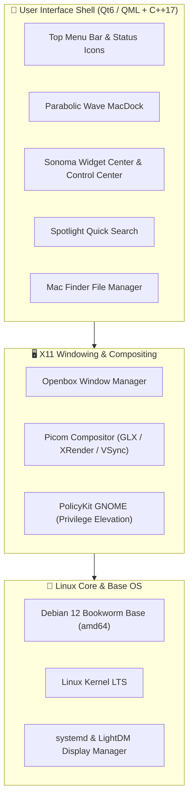

# 🌊 Telaga OS

<div align="center">


-orange?style=for-the-badge)


**Distribusi Sistem Operasi Linux dengan Sensasi macOS Murni (Sonoma & Sequoia) untuk Semua PC.**

[Fitur Utama](#-fitur-khas-macos) •
[Arsitektur](#-arsitektur--teknologi) •
[Struktur Repositori](#-struktur-repositori) •
[Kompilasi & Uji Coba](#-panduan-kompilasi--instalasi) •
[Pintasan Keyboard](#-pintasan-keyboard-shortcuts)

</div>

---

## 📖 Tentang Telaga OS

**Telaga OS** adalah distribusi sistem operasi berbasis **Debian 12 (Bookworm)** yang dirancang dari nol untuk menghadirkan **keanggunan, kemewahan, dan fluiditas antarmuka macOS langsung di komputer atau laptop PC standar**, tanpa perlu hardware Apple mahal atau kerepotan instalasi Hackintosh yang rentan rusak.

Berbeda dengan tema desktop biasa (*GTK/icon themes*), antarmuka desktop Telaga OS dikembangkan secara native menggunakan **C++17** dan **Qt6 Quick / QML**. Hal ini menghasilkan performa grafis 60+ FPS yang sangat ringan, animasi berbasis fisika cairan yang presisi, serta konsumsi sumber daya RAM dan CPU yang sangat hemat.

---

## ✨ Fitur Khas macOS

Telaga OS menghadirkan interaksi mikro legendaris Apple yang dicintai pengguna:

| Fitur | Deskripsi |
| :--- | :--- |
| 🌊 **Parabolic Wave Dock** | Pembesaran ikon kontinu matematis berbasis kurva kosinus saat kursor mouse menyapu barisan ikon di Dock bawah. |
| 🧞 **Genie Minimize Effect** | Saat jendela diminimalkan (klik tombol kuning atau `Cmd+M`), jendela terhisap elastis ke dalam ikon Dock, dan memuai keluar kembali saat dibuka. |
| 🏀 **App Bouncing Animation** | Ikon aplikasi melompat naik-turun secara dinamis di Dock saat aplikasi sedang dimuat/dibuka. |
| 🪟 **Mission Control (Exposé)** | Akses *bird's-eye view* via tombol **`F3`** atau ikon top bar **`⊞`** untuk melihat seluruh jendela yang aktif dan berganti ruang kerja (*virtual desktop spaces*). |
| 🔍 **Spotlight Search** | Launcher cerdas mengambang di tengah layar (**`Ctrl+Space`**) dengan pencarian instan aplikasi, dokumen, dan pengaturan sistem. |
| 🎛️ **Control Center & Floating HUD** | Panel kontrol terpadu untuk Wi-Fi, Bluetooth, Volume, Kecerahan, dan Mode Gelap, disertai kotak HUD kaca melayang di tengah layar saat menyesuaikan volume/kecerahan. |
| 📅 **Widget & Notification Center** | Panel *slide-in* dari tepi kanan layar (gaya macOS Sonoma & Sequoia) berisi Widget Jam Dunia, Kalender, Cuaca, dan Catatan Cepat. |
| 🚦 **Traffic Light Window Controls** | Tombol navigasi jendela khas macOS: 🔴 Tutup, 🟡 Minimalkan (Genie), 🟢 Maksimalkan, lengkap dengan glyph interaktif saat kursor diarahkan (*hover*). |
| 💎 **Apple Squircle & Glassmorphism** | Ikon standar kurva superellipse resolusi tinggi dengan efek *glass sheen* dan bayangan drop-shadow lembut. |

---

## 🏗️ Arsitektur & Teknologi

Telaga OS menggabungkan kestabilan kernel Linux enterprise dengan antarmuka modern generasi baru:



- **Base Distribution**: Debian 12 (Bookworm) Stable `amd64`.
- **UI Framework**: Qt 6 (Core, Gui, Qml, Quick, QuickControls2).
- **Core Language**: C++17 murni untuk kinerja komputasi dan manajemen proses.
- **Window Management**: Openbox dengan konfigurasi borderless & supervised process execution.
- **Hardware Acceleration**: Picom Compositor dengan backend GLX/OpenGL untuk efek bayangan dan transparansi halus tanpa *screen tearing*.
- **Display Manager**: LightDM dengan integrasi autologin bebas hambatan pada sesi Live.
- **Aplikasi Bawaan**:
  - 🌐 Browser: Firefox ESR
  - 🖥️ Terminal: Alacritty (Akselerasi GPU)
  - 📁 File Manager: PCManFM (disesuaikan dengan gaya Apple Finder)

---

## 📁 Struktur Repositori

```text
telaga-os/
├── desktop/                        # Shell Desktop Native Telaga OS
│   ├── panel/                      # Kode sumber C++ dan QML
│   │   ├── qml/                    # Tampilan antarmuka berbasis QML
│   │   │   ├── components/         # Komponen UI: MacDock, TopBar, ControlCenter, dll.
│   │   │   ├── LauncherMenu.qml    # Menu aplikasi utama
│   │   │   └── MainPanel.qml       # Panel root & manajemen jendela
│   │   ├── src/                    # Backend C++ (AppModel, SystemInfo, ThemeProvider)
│   │   ├── panel.pro               # Konfigurasi qmake project
│   │   └── resources.qrc           # Qt Resource Bundle
│   └── session/                    # Skrip inisialisasi sesi desktop
│       ├── telaga-session          # Skrip bootstrap sesi, compositing & daemon
│       └── telaga.desktop          # XSession desktop entry
├── distro-builder/                 # Toolkit Pembuat Distribusi OS
│   ├── build-deb.sh                # Script pembuat paket .deb mandiri
│   ├── build-iso.sh                # Script pembuat Live ISO Debian 12 bootable
│   └── run-live.sh                 # Script pengujian ISO instan via QEMU (KVM)
├── branding/                       # Aset visual & identitas merek
│   └── wallpapers/                 # Wallpaper bawaan Telaga OS
├── .gitignore                      # Konfigurasi filter berkas Git
└── README.md                       # Dokumentasi resmi proyek
```

---

## 🚀 Panduan Kompilasi & Instalasi

### 1. Kebutuhan Sistem (Dependencies)

Untuk membangun dan menguji desktop shell di sistem Debian/Ubuntu:

```bash
sudo apt update
sudo apt install -y \
    build-essential \
    qt6-base-dev \
    qt6-declarative-dev \
    qml6-module-qtquick \
    qml6-module-qtquick-controls \
    qml6-module-qtquick-layouts \
    qml6-module-qtquick-templates \
    openbox \
    picom \
    alacritty \
    pcmanfm \
    papirus-icon-theme
```

---

### 2. Kompilasi & Jalankan Desktop Shell Langsung

Anda dapat langsung mengompilasi dan menguji antarmuka Telaga OS di lingkungan desktop yang sedang aktif:

```bash
# Masuk ke direktori panel
cd desktop/panel

# Buat Makefile menggunakan qmake Qt6
qmake6 panel.pro

# Kompilasi dengan seluruh thread CPU
make -j$(nproc)

# Jalankan shell desktop
./telaga-panel
```

---

### 3. Membangun Paket Debian (`.deb`)

Telaga OS menyediakan script packaging mandiri yang dapat berjalan di distribusi Linux apa pun:

```bash
chmod +x distro-builder/build-deb.sh
./distro-builder/build-deb.sh
```

Paket `.deb` siap pakai akan dihasilkan di folder `distro-builder/packages/telaga-desktop_0.1.0_amd64.deb`.

---

### 4. Membangun Bootable Live ISO

Untuk membuat berkas installer ISO bootable penuh berbasis Debian 12 Bookworm:

```bash
# Pastikan dependensi pembuat ISO terpasang
sudo apt install -y debootstrap xorriso isolinux grub-pc-bin grub-efi-amd64-bin mtools squashfs-tools

# Jalankan proses pembuatan ISO (memerlukan hak akses root)
sudo ./distro-builder/build-iso.sh
```

Proses ini akan mengunduh paket resmi Debian minimal, mengonfigurasi kernel Linux, memasang Telaga Desktop, menyematkan konfigurasi autologin, dan mengompresnya menjadi berkas ISO bootable (`distro-builder/output/telaga-os-1.0-live-amd64.iso`).

---

### 5. Menguji Coba ISO di Emulator (QEMU)

Uji berkas ISO hasil kompilasi secara instan dengan akselerasi hardware KVM:

```bash
chmod +x distro-builder/run-live.sh
./distro-builder/run-live.sh
```

Kredensial sesi Live:
- **Pengguna**: `telaga` (Autologin aktif, hak akses `sudo` penuh)
- **Password Default**: `telaga`

---

## ⌨️ Pintasan Keyboard (Shortcuts)

| Pintasan | Aksi |
| :--- | :--- |
| **`Ctrl + Space`** | Membuka / Menutup **Spotlight Search** |
| **`F3`** | Membuka **Mission Control** (Exposé semua jendela & ruang kerja) |
| **Klik Logo Telaga (Kiri Atas)** | Membuka **Menu Sistem Apple / Telaga OS** |
| **Klik Jam & Tanggal (Kanan Atas)** | Membuka bilah **Widget & Notification Center** dari samping |
| **Klik Ikon Control Center (`🎛️`)** | Membuka panel kontrol cepat suara, layar, dan jaringan |
| **Klik Tombol Kuning (`–`)** | Meminimalkan jendela dengan **Efek Genie** ke Dock |
| **Klik Ikon Aplikasi di Dock** | Meluncurkan aplikasi dengan **Efek Bouncing** / Restore jendela |

---

## 🗺️ Roadmap Pengembangan

- [x] Shell Desktop C++ / Qt6 QML dengan efek kosinus Parabolic Dock.
- [x] Animasi Genie Minimize dan Bouncing App Launch.
- [x] Widget Center slide-in (gaya macOS Sonoma & Sequoia) dan Floating HUD.
- [x] Script otomasi build Debian package (`.deb`).
- [x] Script otomasi build Debian 12 Live ISO (Hybrid BIOS/UEFI).
- [ ] Dukungan Wayland Compositor native (menggunakan wlroots / QtWayland).
- [ ] Integrasi Global App Menu Bar (D-Bus `com.canonical.AppMenu.Registrar`).
- [ ] Mode Tema Dinamis (Auto Dark/Light Mode berdasarkan waktu lokal).
- [ ] Integrasi GUI Installer Calamares untuk kemudahan instalasi ke HDD/SSD.

---

## 🤝 Kontribusi

Kontribusi, saran, dan pengajuan *pull request* sangat diterima! Untuk perbaikan bug atau penambahan fitur baru:

1. Buat branch fitur baru (`git checkout -b feature/fitur-keren`).
2. Commit perubahan Anda (`git commit -m 'Menambahkan efek animasi baru'`).
3. Push branch ke repository Anda (`git push origin feature/fitur-keren`).
4. Buat *Pull Request*.

---

## 📜 Lisensi

Telaga OS dilisensikan di bawah lisensi terbuka **GNU General Public License v3.0 (GPL-3.0)**.  
Desain dan estetika terinspirasi oleh keindahan antarmuka macOS oleh Apple Inc.
